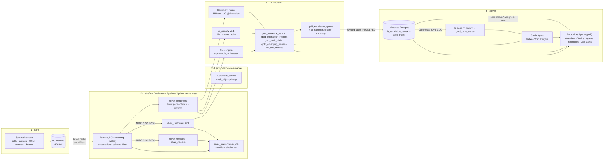

# Valtera Motors · VOC Intelligence

**Catch vehicle safety issues from customer calls in days, not at month-end, and route every serious case to an owner.**

> Valtera Motors is a fictional automaker and **all data is synthetic** (generated by `src/data_gen`). No real customer
> data, rules or names are used. Value figures marked *estimate* are sizing assumptions for an OEM of this size.

## The business problem

Valtera's Customer Experience and Vehicle Quality teams receive about 180K contact-center calls and 60K post-service surveys
a month. Today a **vendor text-analytics tool** tags them with keyword rules, and Quality gets a **month-end export**. Three things go wrong:

1. **Paraphrases are missed.** In this dataset **about 1 in 5 complaints** uses wording the keyword rules never match
   ("that little door where you plug in won't budge").
2. **Safety signals arrive late.** A defect introduced by a software update shows up in the monthly report 3–5 weeks after customers start calling.
3. **Nobody owns the case.** Tagged complaints are not linked to vehicle, dealer or OTA data, and there is no queue or audit trail.

## The outcome

| KPI | Before | After | Basis |
|---|---|---|---|
| Time to detect an emerging safety issue | ~30 days (monthly report) | **2–6 days** | measured: the seeded OTA 4.2 defect (released 2026-10-28) alerted on **2026-10-30** (charge-port door), **2026-10-31** (OTA failure) and **2026-11-03** (unexpected braking) |
| Complaint topics found (recall) | **77.9%** (keyword rules) | **99.4%** (rules + `ai_classify`) | measured against ground truth on noisy, transcript-style text, `evidence/task_outputs/07_evaluate.json` |
| Topic tagging F1 | 0.876 | **0.977** (precision 96.1%: 238 false tags in 6,180) | same |
| LLM calls for classification | 1 per sentence | **4,018 for 11,953 customer sentences (−66%)**; a new day costs only its new wording (43 calls) | `evidence/task_outputs/03_ai_classify.json` |
| Vendor text-analytics license | ~$600K/yr | Databricks consumption ~$60–90K/yr | *estimate* |
| Analyst effort on rule upkeep and tag review | ~5 FTE | ~2.5 FTE (≈ $300K/yr returned) | *estimate* |
| Vehicles exposed to a bad OTA before rollback | full rollout | ~6,000 fewer (4 weeks earlier × 1,500 vehicles/week ≈ $0.9M at $150/vehicle) | *estimate* |
| P1 safety cases | no owner | queue with AI summary, recommended action, assignee and audit log | built |

**Estimated year-1 value: ~$1.6M**, plus lower recall and brand risk. Deck: [`docs/deck.pdf`](docs/deck.pdf) ([source](docs/deck.md)). Demo script: [`docs/demo_script.md`](docs/demo_script.md).

## What it does (the demo)

1. **Overview:** what customers talk about most, how they feel week by week, survey promoters vs. detractors by
   vehicle, and *"4 emerging issues"*. Three are the 2026 Aurora EV after OTA 4.2: charge-port door, unexpected
   braking and OTA failure, with peak lift of 9.6×, 10.4× and 6.5× over the 4-week baseline. The fourth is a spike I did
   *not* plant (2026 Ridgeback Hybrid infotainment, 6.9×, first alert 2026-10-26). That's why an alert opens an analyst review instead of
   escalating automatically.
2. **Topics:** every topic the classifiers found, with volume, % negative and how it was detected; select a topic to read
   what customers actually said (rule keywords or AI confidence and reason per quote).
3. **Escalation queue:** 318 P1/P2 cases served from **Lakebase**. Each has an AI case summary and a recommended action.
   An agent sets status, assignee and a note, saved to Lakebase with an audit log, and streamed **back to the lakehouse**
   with Lakebase Lakehouse Sync (`gold_case_status`), so Genie and reporting see how cases are handled. The loop is closed.
4. **Monitoring:** data freshness, how emerging issues are detected (rule + alert history), how cases are handled
   (status counts, time to first action) and how accurate the tagging is.
5. **Ask Genie:** *"When was the charge port door problem on the 2026 Aurora EV first detected?"* → **2026-10-30**, with
   the generated SQL shown ([`evidence/genie/genie_conversations.md`](evidence/genie/genie_conversations.md)).

App: `https://valtera-voc-app-984752964297111.11.azure.databricksapps.com` (Databricks workspace sign-in required).

## Architecture: one connected flow



**One Lakeflow Job** (`valtera-voc-end-to-end`, 9 tasks, serverless) runs the whole flow. It's **started by a
file-arrival trigger** on the `landing` volume: a new export file starts a run 2 minutes after the writes stop, at most once
every 5 minutes. The synthetic export is landed from outside the job by `scripts/land_export.sh`, which plays the source
system. The job never writes to `landing`, so it can't trigger itself.

| # | Task | What it does | Code |
|---|---|---|---|
| 0 | *(outside the job)* | `scripts/land_export.sh` generates the synthetic export and copies it to the `landing` volume (`backfill` = 90 days, `daily` = one day). This starts the job | `scripts/land_export.sh`, `src/data_gen/` |
| 1 | `lakeflow_ingest` | Python Lakeflow pipeline: Auto Loader (`cloudFiles`) → 4 bronze tables; AUTO CDC → `silver_customers`, `silver_vehicles`, `silver_dealers`; sentence split → `silver_sentences`; `silver_interactions` joins the silver tables; data-quality expectations at every layer | `src/pipeline/*.py` |
| 2 | `governance` | Tags PII, creates the masking function and secure view | `src/notebooks/01_governance.py` |
| 3 | `rule_tagging` | Rule engine (`rule_engine.py` + `tagger.py`) over every customer sentence through a vectorized PySpark `pandas_udf`; writes the sentence text and the words that triggered each tag | `src/notebooks/02_rule_tagging.py` → `src/classification/rule_tag_job.py` |
| 4 | `ai_classify` | `ai_classify` v2.1 multi-label; labels = each topic's `ai_description` from `category_model.json`; confidence ≥ 0.6; one call per distinct sentence, cached by (text, definitions fingerprint); writes the sentence text, confidence and rationale | `src/notebooks/03_ai_classify.py` → `src/classification/ai_classify_job.py`, `ai_common.py` |
| 5 | `sentiment_model` | Weak-labels with `ai_analyze_sentiment`, trains TF-IDF + logistic regression, registers in UC, scores all sentences | `src/notebooks/04_sentiment_model.py` |
| 6 | `gold_and_alerts` | Combined topics, interaction insights, daily topic counts, emerging-issue alerts, escalation queue, metric view | `src/notebooks/05_gold_and_alerts.py` |
| 7 | `lakebase_sync` | Refreshes the Lakebase synced table and checks row counts | `src/notebooks/06_lakebase_sync.py` |
| 8 | `evaluate` | Loads the ground-truth labels, scores rules / AI / combined against them; checks when the OTA 4.2 issue was first detected | `src/notebooks/07_evaluate.py` |
| 9 | `genie_space` | Creates or updates the Genie Agent (column descriptions and synonyms, joins, measures, filters, expressions, example SQL, short instructions, 20 benchmarks), checks every SQL statement on the warehouse, runs the benchmarks and fails below 90% | `src/notebooks/08_genie_space.py` |

## Evidence that it ran (all plain text)

| What | File | Key result |
|---|---|---|
| Final end-to-end job run | [`evidence/job_run_summary.txt`](evidence/job_run_summary.txt) | 9/9 tasks SUCCESS (run `544525181135495`) |
| Notebooks with their outputs | [`evidence/notebooks/`](evidence/notebooks/) | all 8 job notebooks as `.ipynb`, with the cell outputs of that run |
| Deployed asset definitions + status | [`evidence/assets/`](evidence/assets/) | pipeline, job + recent runs, Lakebase project + synced table + Lakehouse Sync, Postgres checks, Genie space, UC model, app |
| File-arrival trigger | [`evidence/triggered_run.md`](evidence/triggered_run.md) | a landed export started the job automatically, 8/8 tasks SUCCESS |
| Incremental daily run | [`evidence/incremental_run.md`](evidence/incremental_run.md) | rebuild wrote **6,166** interactions; the next day's file added only **+70** interactions / +480 sentences; 43 new ai_classify calls |
| Row counts per layer | [`evidence/query_results/table_row_counts.json`](evidence/query_results/table_row_counts.json) | 6,236 interactions → 39,934 sentences → 318 queue rows = 318 in Lakebase |
| Pipeline events | [`evidence/pipeline_events.txt`](evidence/pipeline_events.txt) | flow progress, data-quality metrics |
| Classifier quality | [`evidence/query_results/classifier_quality.json`](evidence/query_results/classifier_quality.json) | F1 0.876 rules / 0.967 AI / 0.977 combined |
| AI-only catches with rationale | [`evidence/query_results/ai_only_catches.json`](evidence/query_results/ai_only_catches.json) | e.g. "It used to get me to my sister's place and back…" → Range Loss (0.78) |
| Explainable rule tags | [`evidence/query_results/explainable_rule_tags.json`](evidence/query_results/explainable_rule_tags.json) | e.g. `"phantom braking"` → Unexpected Braking |
| Emerging issues | [`evidence/query_results/emerging_issues.json`](evidence/query_results/emerging_issues.json) | OTA 4.2 issues first alerted 2026-10-30 / 10-31 / 11-03; 1 unplanted spike (2026-10-26) |
| Sentiment model (MLflow / UC) | [`evidence/task_outputs/04_sentiment_model.json`](evidence/task_outputs/04_sentiment_model.json) | accuracy 0.987, macro-F1 0.982 vs. held-out weak labels (3,948 labelled sentences); interaction mix 62% negative / 30% neutral / 8% positive |
| PII masking | [`evidence/query_results/masked_pii.json`](evidence/query_results/masked_pii.json) | `K******`, `+******` |
| Escalation queue + AI summaries | [`evidence/query_results/escalation_queue_sample.json`](evidence/query_results/escalation_queue_sample.json) | "Car braked suddenly at 45mph, nearly causing rear-end collision." |
| Lakebase sync | [`evidence/task_outputs/06_lakebase_sync.json`](evidence/task_outputs/06_lakebase_sync.json) | sync COMPLETED, 318 = 318 rows, app read access verified |
| App build + deployment | [`evidence/app_validation.txt`](evidence/app_validation.txt), [`evidence/app_status.json`](evidence/app_status.json) | validate: types, lint, typecheck, build, tests pass; app RUNNING |
| Genie answers + generated SQL | [`evidence/genie/genie_conversations.md`](evidence/genie/genie_conversations.md) | 5 business questions answered |
| Genie benchmark evaluation | [`evidence/genie/genie_benchmark_eval.md`](evidence/genie/genie_benchmark_eval.md) | **19/20 (95%)** on 20 benchmarks; the job fails below 90% |
| Unit tests | [`evidence/unit_tests.txt`](evidence/unit_tests.txt) | 16/16 pass (rule engine + ai_classify labels and cache key); app: 3/3 route tests, typecheck, lint, build pass (`databricks apps validate`) |

Every notebook writes its own JSON summary to the `evidence` volume; `scripts/collect_evidence.sh` copies them here, `scripts/export_run_notebooks.py` exports the run's notebooks with outputs, and `scripts/snapshot_assets.sh` snapshots every deployed asset.

## Decisions and trade-offs

| Decision | Why | Trade-off / what I'd do next |
|---|---|---|
| **Keep a rule engine next to the AI** | Deterministic, explainable to Quality and Legal; a vendor's existing rule set can be migrated as data (`category_model.json`) | Two methods, but one taxonomy file drives both (rules + plain-language `ai_description`) |
| **Combine with OR (rules or AI)** | Rules alone miss every paraphrase (0% recall on them). The union gets 99.4% recall at 96.1% precision | On real data rule precision will be below the 100% seen here (the synthetic vocabulary matches the rules by construction) |
| **`ai_classify` instead of `ai_query` + prompt** | Purpose-built, multi-label, returns confidence and a rationale, no prompt to maintain | Fixed Databricks-managed model; `ai_query` with a chosen LLM stays an option |
| **Classify distinct sentences once and cache them** | Contact-center language repeats: 66% fewer calls on this noisy data, and later runs only pay for new wording (43 calls for a new day) | The cache key includes a fingerprint of the definitions, instructions and version, so editing a topic definition re-classifies every sentence (tested in `tests/test_ai_common.py`). A per-label incremental re-score, as in that earlier project's incremental job, would make edits cheaper |
| **Trained sentiment model instead of per-call LLM sentiment** | Zero token cost at volume, deterministic, owned and versioned in UC | Trained on LLM *weak* labels (3,948 distinct sentences in this synthetic set). Next: 500 analyst-labelled sentences |
| **Daily alert rule: ≥10 in 7 days and ≥4× the prior 4-week weekly average** | Simple enough for Safety to trust; checked every day, so the first alert date is known | A 3× threshold produced 2 noise alerts. At 4× it also flags one unplanted low-volume spike, so alerts go to an analyst, and thresholds need tuning on real volume |
| **Lakebase for the queue, Lakehouse Sync back** | Millisecond reads, transactional write-back and an audit log in Postgres; Lakehouse Sync streams case changes back to UC as SCD2 history, so reporting and Genie see case handling with no extra job | Synced table is TRIGGERED (minutes after each job run), not continuous |
| **MERGE the queue, never replace it** | The synced table streams the queue's Change Data Feed. My first version rebuilt it with `CREATE OR REPLACE`, which broke the stream (`DIFFERENT_DELTA_TABLE_READ_BY_STREAMING_SOURCE`) | The sync task now checks Lakebase rows = gold rows and fails otherwise, recovering once with a full refresh |
| **No PII beyond silver** | Gold, Genie and the app only use `customer_id`; names, emails and phones are masked | Agents who need contact details would get them through the PII-reader group |
| **Genie Agent created by a notebook in the job** | Every run re-applies the curated definition (column configs, joins, snippets, examples, short instructions) and re-runs 20 benchmarks, so a data or schema change that breaks Genie fails the job | Benchmarks found real ambiguities (hybrid ≠ ICE, primary vs. any topic, spike = peak_lift), now encoded as column descriptions rather than long instructions |

## How I used AI to build this

Full list: [`docs/ai_tools.md`](docs/ai_tools.md).

- **Claude Code** (Databricks Isaac) was my pair programmer for the whole build: data generator, pipeline SQL, notebooks,
  the AppKit app, tests, evidence and docs. Debugging included the serverless UDF pickling error, the alert-baseline bug,
  the Lakebase change-feed break and a file-arrival trigger loop. I reviewed and directed every change.
- **Databricks agent skills** (`databricks aitools`, v0.2.30): `databricks-core`, `-pipelines`, `-jobs`, `-lakebase`,
  `-apps`, `-app-design`, `-ai-functions` and `-dabs` gave the agent current guidance per product. Both bundles pass
  `bundle validate --strict`.
- **Databricks AppKit** for the app (analytics, Lakebase and Genie plugins, typegen, `apps validate`), the CLI's
  `experimental aitools` SQL tools for checks, and **Genie benchmark evaluation** (20 benchmarks, 85% → 95% after curation; the job fails below 90%).
- **Glean** to find the FE Bar requirements.
- **My own prior work:** the classification code is ported from an earlier VOC project of mine: the rule engine
  (`rule_engine.py`, `tagger.py`), the PySpark `pandas_udf` tagging job (`rule_tag_job.py`)
  and the ai_classify v2.1 track (`ai_common.py`, `ai_classify_job.py`). Only code was reused; the Valtera taxonomy, rules,
  topic definitions and data are new.
- **AI inside the solution:** `ai_classify` (topics), `ai_analyze_sentiment` (weak labels for a trained model),
  `ai_summarize` (case summaries), a Genie Agent (natural-language questions).
- **Checking the AI rather than trusting it:** ground-truth evaluation of every classifier on every run, a
  definition-aware ai_classify cache, Genie benchmarks, generated SQL and a disclaimer on every Genie answer, and
  "verify" labels on AI case summaries in the app.

## Repo layout

```
src/data_gen/          synthetic export generator (pure Python, seeded)
src/pipeline/          Lakeflow Declarative Pipeline (Python: Auto Loader, AUTO CDC, expectations)
src/classification/    rule engine + tagger + category_model.json (the taxonomy)
src/notebooks/         job tasks 00-60
resources/, databricks.yml   bundle: pipeline + job
app/                   Databricks App (AppKit): UI, SQL queries, Lakebase case routes, tests (separate bundle)
tests/                 rule-engine unit tests
evidence/              text evidence of execution
docs/                  presentation deck (deck.md + deck.pdf), demo script for the roleplay, AI tools used
scripts/               evidence collection, Genie evidence, app access setup
```

## How it's deployed

Two Databricks Asset Bundles hold the code-defined resources. Everything else is set up once with a CLI
command, a script, or by a job task the first time it runs. Nothing is created by hand in the UI.

| Resource | Deployed by | Where |
|---|---|---|
| Lakeflow pipeline `valtera-voc-ingest` | **Bundle 1** (root) | `databricks.yml`, `resources/pipeline.yml` |
| Lakeflow Job `valtera-voc-end-to-end` (9 tasks, file-arrival trigger) | **Bundle 1** (root) | `resources/job.yml` |
| Synthetic export (the "source system") | Script, run from a laptop | `scripts/land_export.sh` |
| Databricks App `valtera-voc-app` + its resources (SQL warehouse, Lakebase, Genie space) | **Bundle 2** (app) | `app/databricks.yml`, `app/app.yaml` |
| UC schema `voc_valtera`, volumes `landing` and `evidence` | One-time SQL (step 1 below) | prerequisite |
| Lakebase project `valtera-voc` | One-time CLI command (step 2 below) | prerequisite |
| Tables, views, masking function, metric view | Job tasks (pipeline + notebooks) | `src/pipeline/`, `src/notebooks/` |
| Sentiment model `voc_sentiment_model@champion` | Job task `sentiment_model` (MLflow → UC) | `src/notebooks/04_sentiment_model.py` |
| Lakebase synced table `lb_escalation_queue` | Job task `lakebase_sync` (created on first run, recreated if broken) | `src/notebooks/06_lakebase_sync.py` |
| Lakehouse Sync `case_mgmt` → UC (`lb_case_actions_history`, `lb_case_action_log_history`) | One-time CLI: `databricks postgres create-cdf-config projects/valtera-voc/branches/production/databases/databricks-postgres daria_krasavina voc_valtera case_mgmt --cdf-config-id case_mgmt_to_uc` | the app sets `REPLICA IDENTITY FULL` on its tables |
| Genie Agent "Valtera VOC Insights" | Job task `genie_space` (creates or updates it, then runs the benchmarks) | `src/notebooks/08_genie_space.py` |
| Grants for the app's service principal (UC + Lakebase) | Script, run once after the first app deploy; the sync task re-applies the Lakebase grant | `scripts/setup_app_access.sh` |

The app is a separate bundle because `databricks apps init` scaffolds it that way, and it keeps the Node.js app's
build and deploy cycle independent from the data pipeline.

## Run it

```bash
# 1. Prerequisites (once): schema, volumes, SQL warehouse
databricks experimental aitools tools query "CREATE SCHEMA IF NOT EXISTS daria_krasavina.voc_valtera" --warehouse <id> --profile <profile>
databricks experimental aitools tools query "CREATE VOLUME IF NOT EXISTS daria_krasavina.voc_valtera.landing" --warehouse <id> --profile <profile>
databricks experimental aitools tools query "CREATE VOLUME IF NOT EXISTS daria_krasavina.voc_valtera.evidence" --warehouse <id> --profile <profile>
# 2. Lakebase project (once)
databricks postgres create-project valtera-voc --json '{"spec": {"display_name": "Valtera VOC - escalation queue"}}' --profile <profile>
# 3. Bundle 1: pipeline + job. Landing the 90-day backfill starts valtera-voc-end-to-end via the
#    file-arrival trigger (≈2 min wait + ≈8 min run, serverless)
databricks bundle deploy --profile <profile>
scripts/land_export.sh <profile> backfill
# 4. Genie Agent: created by the job's genie_space task (08_genie_space.py); note its space ID from the task output
# 5. Bundle 2: the app (set the Genie space ID in app/databricks.yml first)
cd app && npm install && databricks bundle deploy --profile <profile> && databricks bundle run app --profile <profile> && cd ..
# 6. Least-privilege grants for the app's service principal
scripts/setup_app_access.sh <profile>
# Tests (no cluster needed)
python -m pytest tests
```

Daily increment: `scripts/land_export.sh <profile> daily YYYY-MM-DD`; the trigger does the rest.
Run the job without a new file: `databricks bundle run voc_end_to_end --profile <profile>`.
After grading, set `pause_status: PAUSED` in `resources/job.yml` and redeploy to stop triggered runs.
The catalog name and warehouse ID are hard-coded in a few places (app SQL queries, Genie script, scripts); change them to deploy elsewhere.

## Limitations

- The data is synthetic, but deliberately noisy (fillers, back-channels, transcription-style text, typos, messy CRM fields; about 4,000 distinct customer sentences). The numbers show the method works; they are not a production benchmark.
- The incremental path has been run for one extra day. Every run retrains the sentiment model and registers a new version; a champion/challenger check before promoting it is a next step.
- Evidence is from the final run `544525181135495` (data 2026-08-22 → 2026-11-20); `scripts/collect_evidence.sh`, `scripts/export_run_notebooks.py` and `scripts/snapshot_assets.sh` regenerate it.
